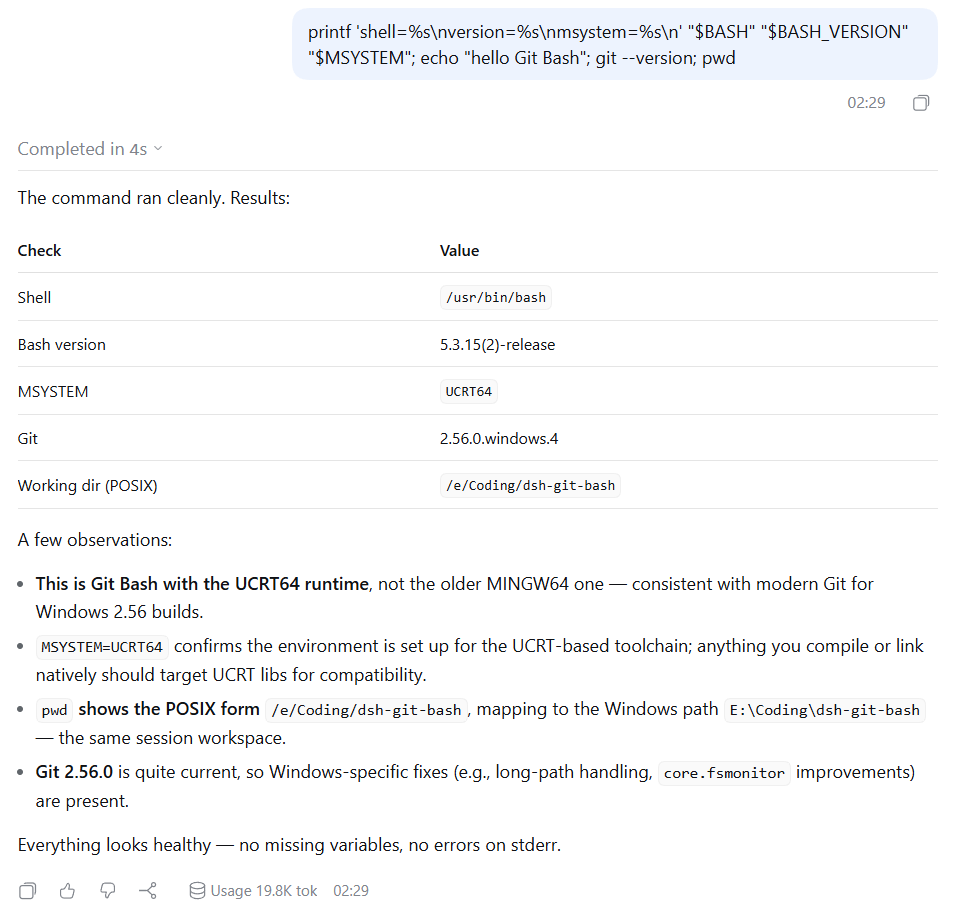

# @dr1n0/dsh-git-bash

> **社区延续版（衍生项目）。** 本仓库衍生自 [inmny/dsh-git-bash](https://github.com/inmny/dsh-git-bash)，
> 接续 [ahtsiu](https://github.com/ahtsiu/dsh-git-bash) 的 `bugfix/adapt-to-0.2.1-rc.5` 分支继续维护 0.2.x 适配。
> 原作者保留全部著作权，本项目按原 MIT 许可分发；包名与原版 `dsh-plugin-git-bash` 区分，
> 因此两者可以独立安装、互不覆盖。原始设计、native guard 与测试矩阵均来自上游。

让 [DeepSeek Harness](https://github.com/deepseek-ai/deepseek-harness) 在 Windows 上默认使用 Git for Windows Bash，并保留 DSH 的 `read-only`、`workspace-write` 和 `danger-full-access` 权限语义。



## 与原项目的差异

相对上游 `dsh-plugin-git-bash`（最后发布 0.3.3）与本延续版的第一批改动：

- **包名**：改为 `@dr1n0/dsh-git-bash`，避免与 npm 上的原版同名冲突。
- **版本号**：采用 `<DSH 版本线>-r<插件修订>`，如 `0.2.2-r1` 表示适配 DSH 0.2.2 系列的第一个插件版本。
- **DSH 0.2.x 适配**：跟随 `execute` seam、Config schema 投影和新的 client 模块注入（来自 ahtsiu 的分支）。
- **UTF-8 输出**：为 Git Bash 固定 `LANG`/`LC_ALL`/`PYTHONUTF8`/`PYTHONIOENCODING`，避免中文（CJK）输出在 GBK 代码页机器上变成乱码或触发 `UnicodeEncodeError`。
- **MSYS 路径转换**：模型或宿主传入的 `/d/work`、`/cygdrive/d/work` 会转成 `D:\work` 再交给 Node 作为工作目录；`/usr/bin` 这类非盘符路径保持原样。
- **host-level 调用分流**：不带 `sandboxPolicy` 的 `ctx.shell` 调用（宿主插件内部调用）不再继承部署沙箱门禁，默认用 Windows PowerShell 执行；可通过 `hostShell: bash` 改回 Git Bash。
- **发布脚本**：`prepack` 只做 TypeScript 编译，不强制重建 native（预编译产物随包分发）。

## 版本号约定

版本号形如 `0.2.2-r1`：

- `0.2.2`：适配的 DSH 版本线（`engines.dsh: ">=0.2.2-rc.1"`）；
- `-r1`：本插件的第 N 个修订。同一条 DSH 线上的插件补丁递增 `-r2`、`-r3`，不会与 DSH 未来的版本号撞车。

兼容性只由 `package.json` 的 `engines.dsh` 下限决定：新版本插件自动接受之后的所有 DSH 版本，不再在每次 DSH 升级时改包；需要旧 DSH 的用户直接安装对应的旧插件版本。

## 使用方法

插件安装到 profile 后，`standard`、`code`、`cordis` 和 `minimal` preset 会使用 Git Bash 代替 PowerShell。前台命令、后台命令和 Web Agent preset 共用同一个 executor。

新建会话后可以运行以下命令确认 shell：

```sh
printf 'shell=%s\nversion=%s\nmsystem=%s\n' "$BASH" "$BASH_VERSION" "$MSYSTEM"
```

`MSYSTEM` 应为 `MINGW64`、`MINGW32` 或 `UCRT64`（Git for Windows 2.56 起默认 UCRT64）。

Web 界面中的 Bash 工具行可以展开查看 command、cwd、stdout/stderr 和 exit status。`run_code` 内的 nested Bash 调用使用同一套 terminal 详情；过长的 command 会自动换行，output 则保留终端横向滚动，以维持日志和表格的列对齐。

插件只作为 bundle layer 安装到目标 profile，不修改 DSH 安装目录。

## 安装或更新

从 npm 安装固定版本到 Web profile：

```sh
dsh plugin --profile web add @dr1n0/dsh-git-bash@0.2.2-r1
```

更新现有安装时使用同一条命令。安装完成后重启 `dsh web`，让 Host 和浏览器 client 同时加载新版本，然后新建会话。

开发本地版本时传入 checkout 路径：

```powershell
dsh plugin --profile web add E:\Coding\dsh-git-bash
```

## 权限模式

### `read-only` 和 `workspace-write`

受限命令仍由 DSH Windows ACL sandbox 创建 `WRITE_RESTRICTED` token。插件在 sandbox 内先运行 native guard，再由 guard 启动 Git Bash：

```text
DSH ACL runner -> msys-token-guard.exe -> bash.exe -> child processes
```

- `read-only` 可以启动 Git Bash，但不能写 workspace。
- `workspace-write` 只能写 DSH 授权的 workspace 和 private temp。

### `danger-full-access`

该模式不经过 native guard，直接运行 Git Bash，与插件 0.1.x 的执行方式一致。

## 配置 Git Bash 路径

插件会自动探测 Program Files、用户安装目录和 Scoop 中的 Git Bash。Web GUI 侧栏打开「插件」，进入本插件的 `git-bash-shell` 配置页后可以直接输入 `bash.exe` 路径，或通过 `选择 Git 安装目录` 调用系统路径选择窗口。保存后，后续 Bash 命令会立即使用新路径；恢复默认值会回到 profile 配置或自动探测结果。

无 GUI 场景可以在启动 DSH 前设置 `DSH_GIT_BASH_PATH`：

```powershell
$env:DSH_GIT_BASH_PATH = 'D:\Apps\Git\bin\bash.exe'
dsh web
```

也可以直接在 profile 的 `cordis.patch.yml` 中为 provider 配置 `executable`：

```yaml
- id: git-bash-shell
  name: '@dr1n0/dsh-git-bash'
  config:
    executable: D:\Apps\Git\bin\bash.exe
```

## 配置 host-level shell

一些宿主插件会直接调用 `ctx.shell` 而不带 sandbox policy。这类调用默认走 Windows PowerShell，因为它们通常是按平台默认 shell 写的：

```yaml
- id: git-bash-shell
  name: '@dr1n0/dsh-git-bash'
  config:
    hostShell: pwsh   # 默认；设为 bash 则所有 host 调用也走 Git Bash
```

| 值 | 行为 |
| --- | --- |
| `pwsh`（默认） | `ctx.shell` 的 host 调用用 `pwsh.exe`（找不到 PowerShell 7 时回退到 Windows PowerShell 5.1），不经过沙箱 |
| `bash` | host 调用也用 Git Bash 执行，不经过沙箱 |

带 `sandboxPolicy` 的工具调用不受此项影响，始终按所选权限模式走 Git Bash + sandbox。

## 平台支持

运行时要求：

- Windows x64
- Node.js 24 或更高版本
- DSH 0.2.2 系列（`0.2.2-rc.1` 及以上，`<0.2.3`；0.2.3 起需要新的插件版本）
- Git for Windows x64

npm 包包含预编译的 `msys-token-guard.exe` 和 `msys-token-guard-hook.dll`，普通安装不需要 Visual Studio 或 CMake。当前 native guard 仅支持 `win32-x64`；其他架构在受限模式下返回 `SANDBOX_UNAVAILABLE`，不会降级到未隔离执行。

Microsoft Detours 4.0.1 源码按 MIT 许可存放在 `native/vendor/detours`，许可文本随 npm 包分发。Detours 的 DLL path 参数使用 Windows ANSI API，因此插件安装路径必须能由当前系统代码页无损表示，并且不能超过 `MAX_PATH`；不满足条件时 guard 会 fail closed。

## 验证与兼容性

本版本的验证环境：Windows 11、Git for Windows 2.56.0（UCRT64 运行时、bash 5.3.15）、DSH 0.2.2-rc.1。`pnpm test` 的 36 个用例全部通过，包括 `read-only` / `workspace-write` 的真实 ACL 权限矩阵和 native guard 的 fail-closed 用例。

Git for Windows 2.52（MINGW64、bash 5.2）上受限模式会失败：

```text
cygheap_user::init: NtSetInformationToken (TokenDefaultDacl), 0xC0000022
fatal error - couldn't create signal pipe, Win32 error 5
```

MSYS 在初始化阶段重写自己的 token default DACL 被 ACL 沙箱拒绝，native guard 的 hook 在该 Git 版本上未能拦截。升级到 2.56 后该问题消失（同一套测试全绿）；在 2.52 上 `danger-full-access` 不受影响。

## 开发

安装依赖并运行完整验证：

```sh
pnpm install
pnpm test        # 完整构建（含 native）+ 全部测试
pnpm build:ts    # 只编译 TypeScript（发布用，不要求 MSVC）
pnpm run pack:check
```

在 Windows 上重建 native artifact 还需要 Visual Studio C++ Build Tools 和 CMake 3.25 或更高版本。`pnpm test` 会以 C++20、静态 MSVC runtime、CFG、CET、ASLR 和 NX 构建 native guard，然后运行 Windows ACL permission matrix、fail-closed、Web client 和 package metadata 测试。

非 Windows 主机不会交叉编译 native guard，只会检查预编译 artifact 是否存在。

## License

MIT。原始版权归 [inmny/dsh-git-bash](https://github.com/inmny/dsh-git-bash) 的作者；0.2.x 适配来自 [ahtsiu](https://github.com/ahtsiu/dsh-git-bash)。
